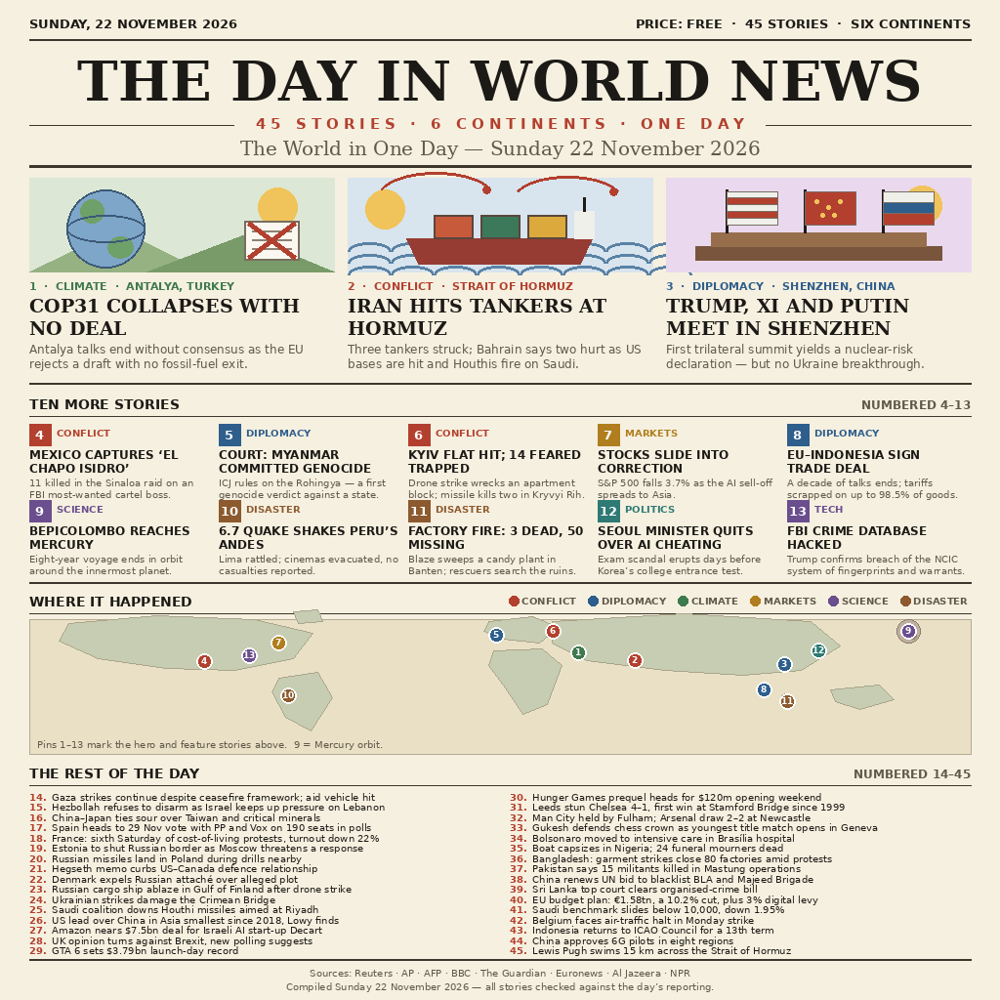

# The World in One Day — Sunday 22 November 2026

[](https://make.fun/c/news-image-20261122)
[](https://make.fun/c/news-image-20261122/leaderboard)
[](https://make.fun/c/news-image-20261122)

A one-page newspaper front page (1024×1024) summing up **45 real world-news
stories from Sunday 22 November 2026** — COP31 collapsing with no deal, Iran
striking tankers at Hormuz, and the first Trump–Xi–Putin trilateral summit in
Shenzhen, plus ten more numbered features, a "Where It Happened" world map
with numbered pins, and 32 more briefs across six continents.

Built for the [make.fun](https://make.fun) bounty
[`news-image-20261122`](https://make.fun/c/news-image-20261122)
— $100, top 50 paid. Referral: `rwrq8ddk`.



## Run it

```sh
python3 main.py   # writes entry.png (1024x1024)
```

Requires Python 3 and Pillow (`pip install pillow`). No network access, no
assets: every illustration is drawn from scratch with PIL primitives, and
the DejaVu fonts ship with most Linux systems.

## Layout

- **Masthead** — "THE DAY IN WORLD NEWS" with the day's date line.
- **3 heroes** — COP31, Hormuz, Shenzhen, each with a flat pastel
  editorial illustration.
- **10 features** — numbered 4–13, two rows of five.
- **World map** — "WHERE IT HAPPENED", pins 1–13 colour-coded by topic.
- **32 briefs** — numbered 14–45 in two columns, plus a sources footer.

## Sources

Reuters, AP, AFP, BBC, The Guardian, Euronews, Al Jazeera, NPR — all
stories checked against reporting published on 22 November 2026.

## License

MIT — see [LICENSE](LICENSE).
